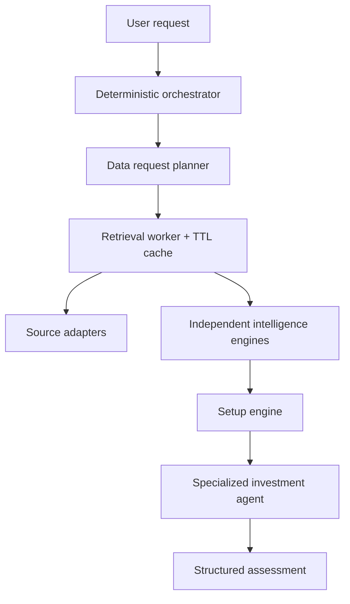
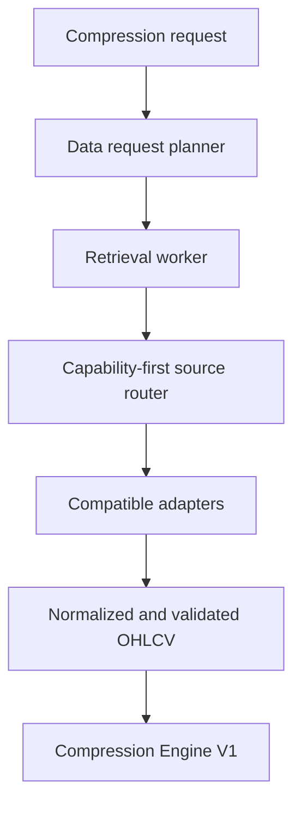
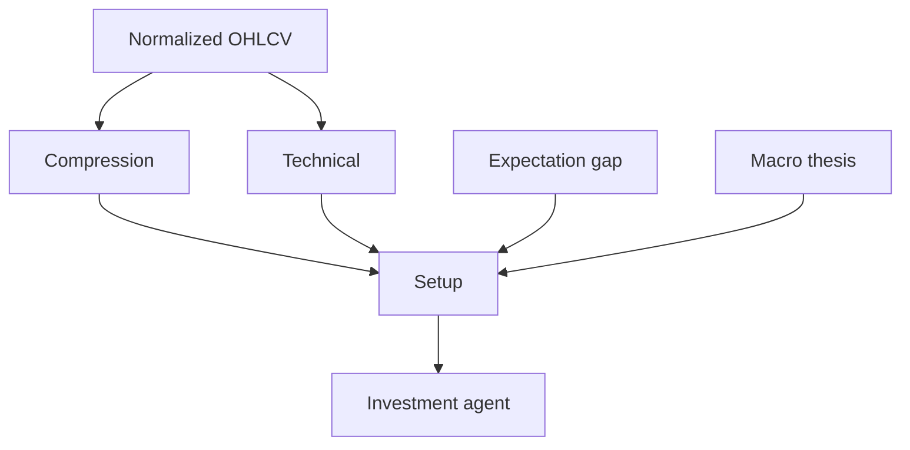

# Victor Investment OS — Phase 2

Implementation-ready Python architecture for a just-in-time investment intelligence system. Phase 2 adds a real free-first OHLCV path and deterministic Compression Engine V1. The other intelligence engines and agent remain Phase 1 mocks. Compression output describes market behavior only; it is not a trade recommendation.

## Architecture



The original orchestrator builds a declared dependency graph, rejects cycles, obtains an execution order from the graph, and runs ready nodes concurrently. Phase 2 also provides a focused dependency slice:



The full Phase 1 mock graph remains available:



### Component boundaries

| Type | Components | Phase 1 behavior |
|---|---|---|
| Deterministic control/integration | Orchestrator, planner, router, worker, adapters | Real OHLCV route plus retained mock route |
| Deterministic intelligence | Compression | Real V1 feature-vector implementation; no composite score |
| Retained Phase 1 mocks | Technical, Setup | No Phase 2 methodology changes |
| Hybrid intelligence | Expectation Gap, Macro Thesis | Interfaces and placeholders only |
| Agentic reasoning | Specialized Investment Agent | Real provider-independent interface using `MockLLMProvider` |

LLMs receive only structured engine outputs. They do not retrieve data, compute indicators, or fill missing evidence. `GeminiProvider` and `OpenAIProvider` are intentionally unconfigured placeholders behind the same `LLMProvider` interface.

## Just-in-time data philosophy

Each intelligence engine declares `DataRequirement` objects. It never calls an external source. The planner groups only compatible requirements by asset, dataset type, frequency, and normalization, then applies:

- union of required fields;
- maximum lookback and minimum-observation requirement;
- minimum `max_age_seconds` (strictest freshness);
- strictest proxy policy.

The worker checks an in-memory TTL cache, asks the source router for dataset-compatible adapters, validates normalized records, and falls back after source or validation failure. No permanent data warehouse is present.

`lookback_bars` is used for feature windows. Historical percentile contexts use explicit timestamp boundaries. A five-calendar-year context is therefore five years for both an ETF and 24/7 crypto even though their observation counts differ.

## Real data sources and routing

Source applicability is evaluated before source tier. Tier is provenance quality, not a global priority list.

| Asset/data role | Preferred route | Fallback | Adjustment |
|---|---|---|---|
| US stock/ETF daily OHLCV | [Alpaca Historical Bars](https://docs.alpaca.markets/us/reference/stockbarsingle-1), with free Basic credentials | Yahoo structured chart JSON | Alpaca `adjustment=all`; Yahoo provider-adjusted OHLC via `adjclose/close` |
| Crypto daily OHLCV | [Coinbase Exchange candles](https://docs.cdp.coinbase.com/api-reference/exchange-api/rest-api/products/get-product-candles) | Yahoo structured chart JSON | Not applicable |

Alpaca Basic covers US stocks/ETFs historically since 2016 and requires `ALPACA_API_KEY_ID` plus `ALPACA_API_SECRET_KEY`. Coinbase is public but limits one response to 300 candles, so its adapter paginates by date. Yahoo requires no key and is a structured endpoint rather than HTML scraping, but it is undocumented and therefore explicitly marked Tier 3 with a warning.

Alpha Vantage was evaluated but not selected: its full-length daily output and adjusted daily endpoint are currently premium, so it cannot provide the required free five-year adjusted path.

Source tiers are `TIER_1` through `TIER_5` and remain separate from `DIRECT`, `RECONSTRUCTED`, `PROXY`, `INFERRED`, and `UNAVAILABLE` data classifications.

## Compression Engine V1

The engine calculates these deterministic raw feature series for configurable bar windows (defaults: 20, 60, 126, 252):

- annualized realized volatility from log returns;
- simple rolling ATR divided by current close;
- Bollinger Band width using configurable standard-deviation multiplier;
- rolling highest-high minus lowest-low, divided by current close;
- 20-bar average volume divided by 60-bar average volume.

For each relevant feature/window, current, five-bars-ago, and twenty-bars-ago values are exposed. Historical normalization uses a primary trailing five-calendar-year context and secondary trailing three-calendar-year context, selected by timestamps. Each context records its actual observation count.

The percentile convention is inclusive average rank: minimum raw value is `0.0`, maximum is `1.0`, and ties use their average rank. For RV, normalized ATR, BBW, and rolling range, lower raw values mean stronger compression, so `compression_percentile = 1 - raw_percentile`. Both numbers are stored. Volume activity is contextual and is not inverted.

There is deliberately no composite compression score, weighting system, directional label, or investment implication.

## Contracts and failures

JSON Schemas live in `contracts/v1`. `contract_version: "1.0"` is part of the envelope. Future breaking changes should create `contracts/v2`; additive backward-compatible changes may extend v1 without changing existing semantics.

Supported modes are `live`, `backtest`, `replay`, and `simulation`; only the live-shaped mock path is exercised. Predictable failures are represented using `INSUFFICIENT_DATA`, `DATA_UNAVAILABLE`, `SOURCE_FAILURE`, `VALIDATION_FAILED`, `DEPENDENCY_FAILED`, `CIRCULAR_DEPENDENCY`, `ENGINE_FAILED`, and `AGENT_FAILED`.

Partial execution is explicit. In Phase 1, Setup may run with a subset of intelligence engines and must list missing engines and lower confidence. The Investment Agent requires Setup. Missing dependencies are never silently marked successful.

## Run pipelines

Python 3.11+ is required.

```bash
python -m venv .venv
source .venv/bin/activate
pip install -e '.[dev]'
python examples/analyze_slv.py
python examples/analyze_slv_compression.py
python examples/smoke_assets.py
pytest -q
```

Or, after installation:

```bash
victor-analyze-slv
victor-compression-slv
```

The first command preserves the Phase 1 mock assessment. The second performs the real SLV Compression analysis. The third runs SLV, GLD, AAPL, QQQ, and BTC-USD smoke tests. Live examples can fail or fall back when a provider is unavailable; unit tests use deterministic fixtures and do not require network access.

Daily analysis conservatively excludes the current calendar day's potentially incomplete bar. Retrieval includes two extra calendar years so the 252-bar feature has enough warm-up for five-year percentiles and twenty-bar change comparisons.

## Extension points

- Add an adapter by implementing `SourceAdapter.supports()` and `retrieve()` and returning normalized `Dataset` plus `Provenance`.
- Add or replace an engine by implementing `IntelligenceEngine.requirements()` and `run()`.
- Add a real LLM by implementing `LLMProvider.generate_structured()`; no Investment Agent business logic needs to change.
- Change topology by declaring different `Node.dependencies`; the executor derives ordering rather than relying on a hard-coded sequence.
- Future Catalyst and Positioning/Flow engines can become additional Setup dependencies without changing raw-data boundaries.

## Contract changes from Phase 1

All changes remain within `contracts/v1` and are additive or explicitly dual-shape.

| Contract | Old | New | Compatibility impact |
|---|---|---|---|
| `common.schema.json` | Free-form source tier; numeric confidence | Formal Tier 1–5 enum plus `MOCK`; nullable confidence; adjustment policy | Existing Phase 1 mock provenance remains valid |
| `data_request_planner.schema.json` | `lookback_days` only | Adds `lookback_bars`, date boundaries, optional fields, context years, calendar type | Old fields remain required and accepted |
| `data_worker.schema.json` | Records plus provenance | Adds optional dataset metadata for dates, currency, calendar, adjustment, counts | Existing datasets without metadata remain valid |
| `compression_engine.schema.json` | Phase 1 mock score shape | Accepts either legacy mock shape or real V1 feature-vector shape | Phase 1 mock output remains valid; V1 introduces no score |

## Deliberate assumptions

- Feature windows are bar-based; percentile contexts are calendar-time based.
- Frequency compatibility is exact string equality; no resampling is performed.
- Normalization compatibility is exact equality; no adjustment conversion is performed.
- Proxy strictness is `DISALLOW > ALLOW_WITH_WARNING > ALLOW`.
- Equity expected-observation diagnostics count weekdays but do not yet use an exchange-holiday calendar; this is labeled as an estimate.
- Realized volatility uses annualization factor 252 for US equity sessions and 365 for continuous crypto.
- Historical context sufficiency requires timestamp coverage and configurable 80% observation density; this is a data-quality rule, not an investment threshold.
- Setup's score/state are fixed mock values, not a scoring model.
- Hybrid engines return methodology-not-implemented placeholders rather than pretending to reason.

## Explicitly out of scope

No Technical, Expectation Gap, Macro Thesis, Setup, or Investment Agent methodology was added. There is no composite Compression score, UI, database, permanent warehouse, options engine, catalyst engine, flow engine, radar, position sizing, backtesting, LLM reasoning, or Phase 3 work.
