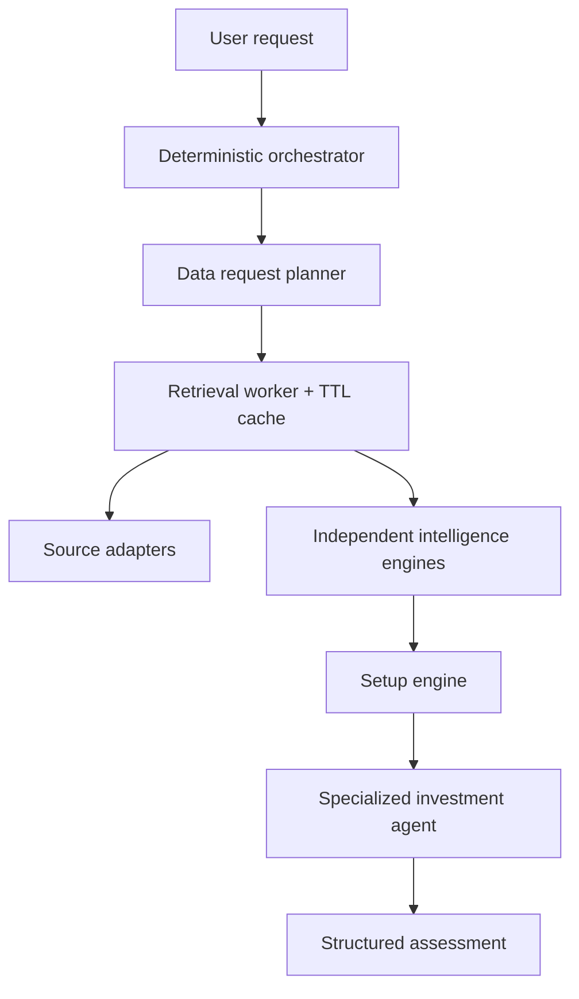
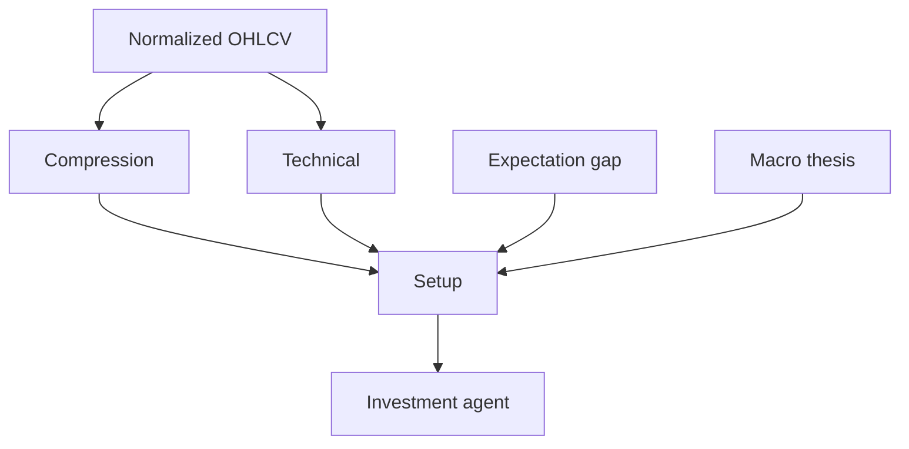

# Victor Investment OS — Phase 1

Implementation-ready Python architecture for a just-in-time investment intelligence system. Phase 1 contains contracts, interfaces, deterministic orchestration, mocks, and tests only. Every numerical assessment in the example is synthetic and must not be used for investment decisions.

## Architecture



The orchestrator builds a declared dependency graph, rejects cycles, obtains an execution order from the graph, and runs ready nodes concurrently. The current Phase 1 graph is:



### Component boundaries

| Type | Components | Phase 1 behavior |
|---|---|---|
| Deterministic control/integration | Orchestrator, planner, worker, adapters | Real architecture with mock source |
| Deterministic intelligence | Compression, Technical, Setup | Interfaces plus explicitly labeled fixed mock outputs; no methodology |
| Hybrid intelligence | Expectation Gap, Macro Thesis | Interfaces and placeholders only |
| Agentic reasoning | Specialized Investment Agent | Real provider-independent interface using `MockLLMProvider` |

LLMs receive only structured engine outputs. They do not retrieve data, compute indicators, or fill missing evidence. `GeminiProvider` and `OpenAIProvider` are intentionally unconfigured placeholders behind the same `LLMProvider` interface.

## Just-in-time data philosophy

Each intelligence engine declares `DataRequirement` objects. It never calls an external source. The planner groups only compatible requirements by asset, dataset type, frequency, and normalization, then applies:

- union of required fields;
- maximum lookback and minimum-observation requirement;
- minimum `max_age_seconds` (strictest freshness);
- strictest proxy policy.

The worker checks an in-memory TTL cache, tries supporting adapters in priority order, validates the normalized records, and falls back after source or validation failure. No permanent data warehouse is present.

## Contracts and failures

JSON Schemas live in `contracts/v1`. `contract_version: "1.0"` is part of the envelope. Future breaking changes should create `contracts/v2`; additive backward-compatible changes may extend v1 without changing existing semantics.

Supported modes are `live`, `backtest`, `replay`, and `simulation`; only the live-shaped mock path is exercised. Predictable failures are represented using `INSUFFICIENT_DATA`, `DATA_UNAVAILABLE`, `SOURCE_FAILURE`, `VALIDATION_FAILED`, `DEPENDENCY_FAILED`, `CIRCULAR_DEPENDENCY`, `ENGINE_FAILED`, and `AGENT_FAILED`.

Partial execution is explicit. In Phase 1, Setup may run with a subset of intelligence engines and must list missing engines and lower confidence. The Investment Agent requires Setup. Missing dependencies are never silently marked successful.

## Run the mock SLV pipeline

Python 3.11+ is required.

```bash
python -m venv .venv
source .venv/bin/activate
pip install -e '.[dev]'
python examples/analyze_slv.py
pytest -q
```

Or, after installation:

```bash
victor-analyze-slv
```

Expected assessment state: `WATCH`. The opportunity score is a fixed mock fixture, separate from `action_triggered`, which remains `false`.

## Extension points

- Add an adapter by implementing `SourceAdapter.supports()` and `retrieve()` and returning normalized `Dataset` plus `Provenance`.
- Add or replace an engine by implementing `IntelligenceEngine.requirements()` and `run()`.
- Add a real LLM by implementing `LLMProvider.generate_structured()`; no Investment Agent business logic needs to change.
- Change topology by declaring different `Node.dependencies`; the executor derives ordering rather than relying on a hard-coded sequence.
- Future Catalyst and Positioning/Flow engines can become additional Setup dependencies without changing raw-data boundaries.

## Deliberate Phase 1 assumptions

- Calendar-day lookback is used only to create deterministic mock fixtures; market-calendar semantics are deferred.
- Frequency compatibility is exact string equality; no resampling is performed.
- Normalization compatibility is exact equality; no adjustment conversion is performed.
- Proxy strictness is `DISALLOW > ALLOW_WITH_WARNING > ALLOW`.
- Source tiers are strings because the final tier taxonomy is a Phase 2 decision.
- Setup's score/state are fixed mock values, not a scoring model.
- Hybrid engines return methodology-not-implemented placeholders rather than pretending to reason.

## Explicitly out of scope

No investment formula, real market-data integration, UI, database, warehouse, options engine, catalyst engine, flow engine, radar, position sizing, backtesting, or Phase 2 methodology is included.

